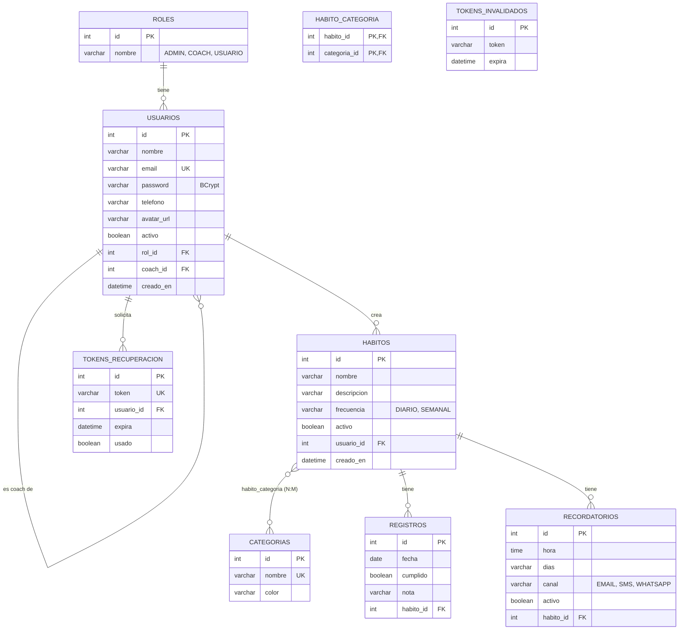
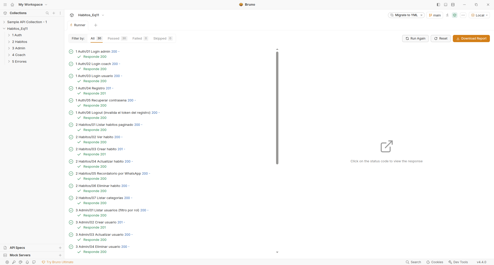
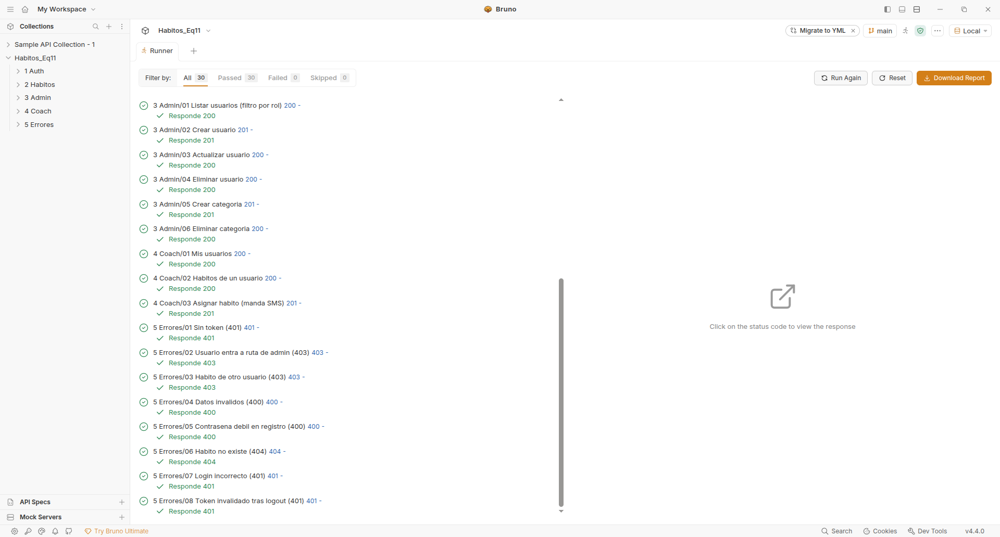

# Hábitos — Proyecto Final (Equipo 11)

Aplicación web para crear, organizar y dar seguimiento a hábitos personales. Los usuarios registran sus hábitos y su avance, los coaches acompañan a los usuarios que tienen asignados y les proponen hábitos nuevos, y el administrador gestiona usuarios y categorías. El sistema avisa a los usuarios por correo, SMS y WhatsApp.

**Integrantes**
- Eduardo Yael Mendoza Martínez — backend, base de datos, seguridad, Bruno y despliegue
- Youri Jorkaeff Ruiz Chávez — frontend en React, diseño en Figma

## Enlaces

| | |
|---|---|
| Aplicación (HTTPS) | https://habitos.194-195-86-95.sslip.io |
| URL base de la API | https://habitos.194-195-86-95.sslip.io/api |
| Tablero de GitHub Projects | https://github.com/users/EduardoY24/projects/5 |
| Prototipo en Figma | https://www.figma.com/proto/XKZc41AhWo12sTfNCqHdcr/Proyecto-Final---H%C3%A1bitos--eq11-?node-id=3-492&p=f&t=KzPVsRTUlyaKz16I-0&scaling=min-zoom&content-scaling=fixed&page-id=1%3A2&starting-point-node-id=3%3A6 |
| Paleta, logo y tipografía (Figma) | https://www.figma.com/proto/XKZc41AhWo12sTfNCqHdcr/Proyecto-Final---H%C3%A1bitos--eq11-?node-id=1-3&p=f&t=H72EwgThdO8sRsLZ-0&scaling=min-zoom&content-scaling=fixed&page-id=0%3A1 |

## Credenciales de prueba

Todas las cuentas vienen en los datos de prueba (migración `V2__datos_prueba.sql`).

| Rol | Email | Contraseña | Qué puede hacer |
|---|---|---|---|
| **Administrador (evaluación)** | `admin@habitos.com` | `Admin123!` | Acceso total: CRUD de usuarios, categorías y todos los hábitos |
| Coach | `coach1@habitos.com` | `Coach123!` | Ve a sus usuarios asignados, sus hábitos y les asigna hábitos nuevos |
| Coach | `coach2@habitos.com` | `Coach123!` | Igual que el anterior, con otros usuarios |
| Usuario | `ana@habitos.com` | `Usuario123!` | Solo sus propios hábitos y recordatorios |

Hay 9 usuarios con rol USUARIO (`ana`, `luis`, `maria`, `carlos`, `sofia`, `jorge`, `valeria`, `diego`, `fernanda` @habitos.com), todos con la contraseña `Usuario123!`.

## Tecnologías

| Capa | Tecnologías |
|---|---|
| Backend | Java 21, Spring Boot 4.1, Spring Web, Spring Data JPA (Hibernate), Spring Security, JWT (jjwt), Bean Validation, Flyway, JavaMailSender, Lombok |
| Base de datos | MySQL 8.4 |
| Frontend | React + Vite, React Router, Axios |
| Comunicación | JavaMailSender con SMTP de Gmail (correo), Twilio (SMS y WhatsApp) |
| Servidor | VPS con Nginx, systemd y Let's Encrypt (Certbot) |
| Herramientas | Git y GitHub Projects, Bruno, Figma |

## Diagrama Entidad-Relación



- La relación **muchos a muchos** es entre `habitos` y `categorias`, mediante la tabla intermedia `habito_categoria`.
- `tokens_invalidados` guarda los tokens cerrados con logout, y `tokens_recuperacion` los enlaces para restablecer la contraseña.

## Base de datos

- Las tablas se crean y versionan con **Flyway** (`backend/src/main/resources/db/migration`):
  - `V1__crear_tablas.sql`: las 9 tablas con sus llaves foráneas.
  - `V2__datos_prueba.sql`: datos de prueba (3 roles, 12 usuarios, 10 categorías, 15 hábitos, 28 relaciones hábito-categoría, 26 registros y 12 recordatorios).
- Hibernate **no** crea tablas (`spring.jpa.hibernate.ddl-auto=none`).
- Respaldo completo de la base: `database/respaldo_habitos_db.sql`.

## Funcionalidades

**Seguridad**
- Login, registro, logout con invalidación del token y recuperación de contraseña por correo.
- Autenticación con **JWT** enviado en el header `Authorization: Bearer <token>`.
- Autorización por rol con `SecurityFilterChain` (`/api/admin/**` solo ADMIN, `/api/coach/**` solo COACH) y `@PreAuthorize`.
- Contraseñas guardadas con **BCrypt**. Regla: mínimo 8 caracteres, una mayúscula, un número y un carácter especial, validada en el frontend (bajo el input) y en el backend (Bean Validation).

**Backend**
- API REST con `@RestController`, DTOs de entrada y salida (las entidades nunca se exponen) y validación con `@Valid`.
- Errores en JSON con su código (400, 401, 403, 404, 422, 500) mediante `@RestControllerAdvice`.
- Paginación y filtros del lado del servidor (`page`, `size`, `busqueda`, `categoriaId`, `activo`, `rol`).
- Relaciones `LAZY` con `@EntityGraph` y `@BatchSize` para evitar el problema N+1.

**Frontend**
- Rutas protegidas según el rol.
- Validaciones visibles debajo de cada campo, en tiempo real y al enviar.
- Tablas con paginación y filtros enviados a la API.
- Navbar con nombre, correo, avatar y menú de perfil y cierre de sesión.
- Modales de confirmación (nunca `alert` ni `confirm`), indicadores de carga, manejo de errores de red y diseño responsivo.

**Comunicación con el usuario**
- **Correo** (JavaMailSender → SMTP de Gmail con contraseña de aplicación): bienvenida al registrarse y enlace para recuperar la contraseña, que vence en 30 minutos y solo se puede usar una vez. Se usó el SMTP de Gmail porque el despliegue no tiene dominio propio (usa `sslip.io`) y sin dominio no se pueden publicar los registros SPF y DKIM que Postfix necesita para que los correos no sean rechazados.
- **SMS** (Twilio): cuando un coach le asigna un hábito nuevo a un usuario.
- **WhatsApp** (Twilio): botón "Enviar recordatorio" en la tabla de hábitos.

## Endpoints principales

| Método | Ruta | Rol |
|---|---|---|
| POST | `/api/auth/register` · `/api/auth/login` · `/api/auth/logout` | Público (logout con token) |
| POST | `/api/auth/recuperar` · `/api/auth/restablecer` | Público |
| GET | `/api/habitos?page=0&size=10&busqueda=&categoriaId=&activo=` | Autenticado (el admin ve todos, los demás solo los suyos) |
| GET · POST · PUT · DELETE | `/api/habitos/{id}` | Dueño, su coach o admin |
| POST | `/api/habitos/{id}/recordatorio` | Envía el WhatsApp |
| GET | `/api/categorias` | Autenticado |
| GET · POST · PUT · DELETE | `/api/admin/usuarios` · `/api/admin/categorias` | ADMIN |
| GET | `/api/coach/usuarios` · `/api/coach/usuarios/{id}/habitos` | COACH |
| POST | `/api/coach/usuarios/{id}/habitos` | COACH (envía SMS) |

## Pruebas con Bruno

La colección está en la carpeta `Bruno/` (abrir en Bruno → *Open Collection* → elegir esa carpeta, con el entorno **Local** o **VPS**). Incluye:
- Login de los 3 roles (el token se guarda solo en el entorno) y su uso en las peticiones protegidas.
- CRUD de hábitos, administración de usuarios y categorías, y funciones del coach.
- Casos de error a propósito: sin token (401), acceso denegado por rol (403), hábito de otro usuario (403), datos inválidos (400), contraseña débil (400), recurso inexistente (404), login incorrecto (401) y token invalidado después del logout (401).




## Diseño

Ver [`docs/figma.md`](docs/figma.md) para el detalle de pantallas, la paleta y el logo.

**Paleta y justificación.** La paleta de Hábitos parte de un color primario índigo (#4F46E5). El azul-violeta transmite confianza, calma y concentración, justo lo que se busca en una aplicación para crear rutinas y dar seguimiento personal. Se combina con neutros fríos de la familia pizarra (#1E293B, #64748B, #E2E8F0, #F8FAFC) en un esquema monocromático-análogo: todos los tonos comparten la misma temperatura fría, por lo que la interfaz se ve ordenada y no cansa la vista. Aplica la regla 60-30-10: 60 % fondos claros neutros, 30 % el azul oscuro del sidebar y de los encabezados de tabla, y solo 10 % de índigo para destacar las acciones. Para el significado se usan colores semánticos con contraste complementario respecto al índigo: verde para éxito y estados activos, y rojo para peligro y eliminación; siempre van acompañados de texto, lo que ayuda a personas con poca percepción del color. Todas las combinaciones de texto cumplen el contraste mínimo AA (4.5:1) de WCAG, y se eligió la tipografía Inter por su legibilidad en pantalla.

**Logo.** Cuadro redondeado índigo con una palomita (✓) y la palabra «Hábitos». Es un diseño propio del equipo; la palomita representa el hábito cumplido.

## Instalación local

**Requisitos:** Java 21, Node.js 18+, MySQL 8.

**1. Base de datos**
```sql
CREATE DATABASE habitos_db;
CREATE USER 'habitos'@'localhost' IDENTIFIED BY 'tu_password';
GRANT ALL PRIVILEGES ON habitos_db.* TO 'habitos'@'localhost';
```

**2. Backend**
```bash
cd backend
cp src/main/resources/application.properties.example src/main/resources/application.properties
# Editar application.properties con tus credenciales (MySQL, clave JWT, correo y Twilio)
./mvnw spring-boot:run
```
Flyway crea las tablas y carga los datos de prueba al arrancar. La API queda en `http://localhost:8080/api`.

**3. Frontend**
```bash
cd frontend
npm install
npm run dev
```
En `frontend/.env.development` debe estar `VITE_USE_MOCK=false` y `VITE_API_URL=http://localhost:8080/api`. La aplicación queda en `http://localhost:5173`.

## Seguridad de la configuración

- `application.properties` (con credenciales reales) está en el `.gitignore` y **nunca** se sube al repositorio.
- El repositorio incluye `application.properties.example` con todas las variables necesarias y sin valores reales.

## Despliegue en el VPS

La aplicación corre en el VPS del curso (Ubuntu) con el dominio gratuito `habitos.194-195-86-95.sslip.io`, que apunta a la IP del servidor.

| Parte | Cómo corre |
|---|---|
| Backend | JAR de Spring Boot en el puerto interno 8089, como servicio de systemd (`habitos.service`) que arranca solo y se reinicia si se cae |
| Configuración | `application.properties` de producción junto al JAR (fuera del repositorio, permisos 600) |
| Base de datos | MySQL en el mismo servidor, base `habitos_db` con un usuario propio solo para este proyecto; Flyway crea las tablas al arrancar |
| Frontend | Build de React (`npm run build`) servido por Nginx desde `/var/www/habitos` |
| Proxy | Nginx manda todo lo que empieza con `/api/` al backend en `127.0.0.1:8089` |
| HTTPS | Certificado de Let's Encrypt con Certbot; `http` redirige a `https` |

**Pasos para actualizar**
```bash
# En la laptop
cd backend && ./mvnw clean package -DskipTests
cd ../frontend && npm run build
scp backend/target/habitos-0.0.1-SNAPSHOT.jar usuario@IP:~/habitos/habitos.jar
scp -r frontend/dist usuario@IP:~/habitos/

# En el VPS
sudo systemctl restart habitos
sudo cp -r ~/habitos/dist/* /var/www/habitos/
```

**Servicio de systemd** (`/etc/systemd/system/habitos.service`)
```ini
[Service]
User=eduardo
WorkingDirectory=/home/eduardo/habitos
ExecStart=/usr/bin/java -Xmx256m -jar habitos.jar
Restart=always
```

**Sitio de Nginx** (`/etc/nginx/sites-available/habitos`)
```nginx
server {
    server_name habitos.194-195-86-95.sslip.io;
    root /var/www/habitos;
    location / { try_files $uri $uri/ /index.html; }
    location /api/ { proxy_pass http://127.0.0.1:8089; }
}
```
